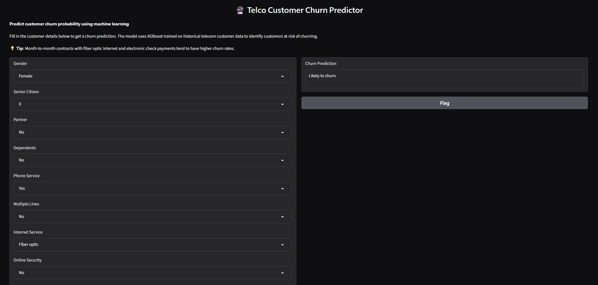
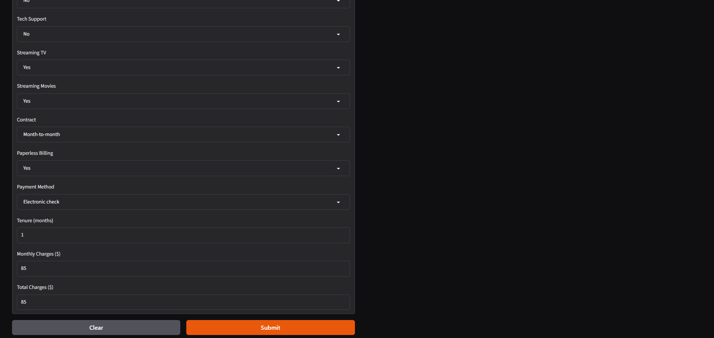
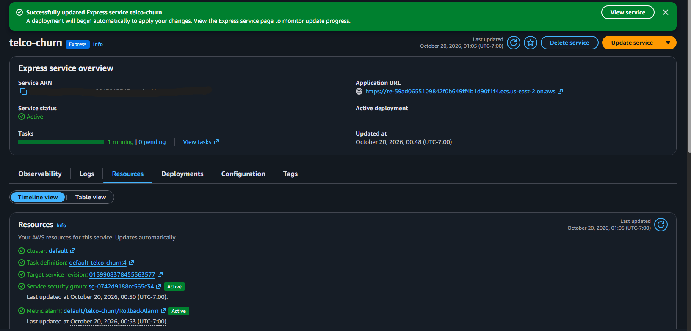

# Telco Customer Churn Prediction

[](https://github.com/montalvoalan/telco-customer-churn/actions/workflows/ci.yml)
[](https://hub.docker.com/r/montalvoalan/telco-fastapi)
[](https://www.python.org/)

An end-to-end machine learning project that identifies telecom customers at risk of churn and serves predictions through a validated API and web interface. The project covers data quality checks, reproducible feature engineering, recall-focused XGBoost training, experiment tracking, containerized inference, continuous integration, and verified AWS deployment.



## Project highlights

- Trained and evaluated on **7,043 customer records** from the IBM Telco Customer Churn sample.
- Reached **82.6% recall** for the churn class on a stratified holdout set.
- Used a **0.35 decision threshold** and class weighting to prioritize finding customers who may leave.
- Added Great Expectations checks before training to catch schema, range, and category problems.
- Kept Optuna tuning inside the training data through stratified cross-validation.
- Exported one self-contained serving bundle containing the model, feature order, category levels, and threshold.
- Served the same inference logic through FastAPI, interactive API documentation, and a Gradio interface.
- Built and smoke-tested the Docker image in GitHub Actions before publishing it to Docker Hub.
- Successfully deployed the tested container to Amazon ECS Fargate with ECS Express Mode.

## Business problem

Customer churn reduces recurring revenue and increases replacement costs. A retention team needs a practical way to find more of the customers who are likely to leave, while understanding that broader outreach will also contact some customers who would have stayed.

This project treats **recall as the primary operating metric**. At the selected threshold, the model finds about 83 of every 100 churners in the holdout data. The corresponding precision shows the tradeoff: about half of the customers flagged by the model are actual churners. That balance can support relatively low-cost retention actions such as targeted emails, service reviews, or limited offers.

## Holdout results

The latest recorded run used a stratified 80/20 split with `random_state=42`. The test set remained separate from fitting and optional hyperparameter tuning.

| Metric | Result | Interpretation |
|---|---:|---|
| Churn recall | **0.826** | Captured 82.6% of customers who churned |
| Churn precision | **0.486** | 48.6% of flagged customers actually churned |
| Churn F1 | **0.612** | Balanced precision and recall at the operating threshold |
| ROC AUC | **0.835** | Strong ranking separation across thresholds |
| Decision threshold | **0.35** | Favors churn detection over fewer false alerts |

These results describe one split of the public sample and do not guarantee performance on future telecom customers. A production rollout would require current customer data, probability calibration, drift monitoring, and a retention-cost analysis to select the final threshold.

## System design

```mermaid
flowchart LR
    A[IBM Telco CSV] --> B[Great Expectations validation]
    B --> C[Cleaning and deterministic encoding]
    C --> D[Stratified train/test split]
    D --> E[Optional Optuna CV on training data]
    E --> F[Class-weighted XGBoost]
    F --> G[Threshold-aware holdout evaluation]
    G --> H[MLflow tracking]
    G --> I[Serving bundle]
    I --> J[FastAPI inference]
    J --> K[Gradio UI and REST API]
    K --> L[Docker image]
    L --> M[GitHub Actions smoke test]
    M --> N[Docker Hub]
    N --> O[AWS ECS Fargate validation]
```



### Modeling workflow

1. Validate required columns, allowed categories, missing values, and numeric ranges.
2. Remove the customer identifier, convert `TotalCharges` to numeric, and encode the churn target.
3. Apply deterministic binary encoding and one-hot encoding with a saved feature order.
4. Create a stratified train/test split to preserve the churn rate.
5. Optionally tune XGBoost with three-fold stratified cross-validation on the training partition only.
6. Fit the final model with `scale_pos_weight` to address class imbalance.
7. Evaluate probabilities at the same threshold used by the deployed application.
8. Log parameters, metrics, and artifacts to MLflow and export the complete serving bundle.

## Application

The application accepts the 19 customer features available in the source dataset, excluding `customerID` and `Churn`. Both interfaces call the same inference function:

- `/ui` provides the Gradio prediction form.
- `/predict` accepts validated JSON through FastAPI.
- `/docs` provides interactive OpenAPI documentation.
- `/` provides the container and load-balancer health check.

<details>
<summary><strong>View the remainder of the prediction form</strong></summary>



</details>

## Deployment validation

GitHub Actions performs the following sequence on every push to `main`:

1. Build the image from `dockerfile`.
2. Start the container on the GitHub-hosted runner.
3. Poll the health endpoint until the service is ready.
4. Submit a representative request to `/predict` and verify a prediction is returned.
5. Publish both the commit SHA tag and `latest` to `montalvoalan/telco-fastapi` on Docker Hub.

The published image was deployed successfully to **Amazon ECS Fargate through ECS Express Mode**. AWS provisioned the HTTPS endpoint, load balancer, networking, health monitoring, and CloudWatch integration. The public service is not maintained as a permanent live demo so the project does not consume idle cloud resources; the deployment result is retained below.



## Run the published container

With Docker installed, run the same tested image published by CI:

```bash
docker pull montalvoalan/telco-fastapi:latest
docker run --rm -p 8000:8000 montalvoalan/telco-fastapi:latest
```

Then open:

- Web interface: `http://127.0.0.1:8000/ui`
- API documentation: `http://127.0.0.1:8000/docs`
- Health check: `http://127.0.0.1:8000/`

The Docker image already contains the trained serving bundle. Running the container does not retrain the model.

## Run the full pipeline locally

The raw CSV is intentionally excluded from Git. Download the [IBM Telco Customer Churn sample](https://www.ibm.com/docs/en/cognos-analytics/12.1.x?topic=samples-telco-customer-churn) and save it as `data/raw/Telco-Customer-Churn.csv`.

```powershell
python -m venv .venv
.\.venv\Scripts\python.exe -m pip install -r requirements.txt
$env:PYTHONIOENCODING = 'utf-8'
.\.venv\Scripts\python.exe scripts/run_pipeline.py `
  --input data/raw/Telco-Customer-Churn.csv `
  --target Churn
.\.venv\Scripts\python.exe scripts/test_fast_api.py
.\.venv\Scripts\python.exe -m uvicorn src.app.main:app `
  --host 127.0.0.1 `
  --port 8000
```

To run training-only Optuna tuning before the final fit:

```powershell
.\.venv\Scripts\python.exe scripts/run_pipeline.py `
  --input data/raw/Telco-Customer-Churn.csv `
  --target Churn `
  --tune `
  --n_trials 20
```

Training writes experiment records to `mlflow.db`, processed data under `data/processed/`, and the deployable model files under `src/serving/model/`. Local experiment files and source data remain untracked.

## Repository structure

```text
telco-customer-churn/
|-- .github/workflows/ci.yml       # Build, smoke test, and publish the image
|-- docs/images/                   # Application and AWS deployment evidence
|-- notebooks/EDA.ipynb            # Exploration and early model comparison
|-- scripts/run_pipeline.py        # End-to-end training orchestration
|-- scripts/test_fast_api.py       # Health and prediction smoke test
|-- src/app/main.py                # FastAPI and Gradio application
|-- src/data/                      # Loading and cleaning
|-- src/features/                  # Deterministic feature encoding
|-- src/models/                    # Tuning, training, and evaluation
|-- src/serving/inference.py       # Production inference path
|-- src/serving/model/             # Model and preprocessing contract
|-- src/utils/                     # Validation and shared paths
|-- dockerfile                     # Python 3.12 serving image
|-- requirements.txt               # Training and development dependencies
`-- requirements-serving.txt       # Smaller pinned serving environment
```

## Technology

| Area | Tools |
|---|---|
| Data and validation | pandas, NumPy, Great Expectations |
| Modeling | XGBoost, scikit-learn, Optuna |
| Experiment tracking | MLflow |
| API and interface | FastAPI, Pydantic, Gradio |
| Packaging and CI/CD | Docker, GitHub Actions, Docker Hub |
| Cloud validation | Amazon ECS, AWS Fargate, Express Mode, CloudWatch |

## Design decisions

- **Recall-focused evaluation:** Missing an actual churner can remove the opportunity for intervention, so the operating threshold prioritizes recall.
- **One serving contract:** The model, threshold, category levels, and ordered feature list are exported together to prevent training-serving mismatches.
- **Training-only tuning:** Optuna never sees the held-out test rows when choosing hyperparameters.
- **Lean serving image:** Runtime dependencies are separated from the larger training environment.
- **Test before publish:** CI publishes an image only after the running container passes health and prediction checks.
- **Cost-aware cloud validation:** AWS deployment was verified and documented without keeping an idle portfolio service online indefinitely.

## Limitations and next steps

- The IBM sample is small and may not represent current customer behavior.
- The model reports a churn classification rather than a calibrated retention value or intervention recommendation.
- Threshold selection should eventually incorporate contact cost, offer cost, customer value, and expected retention lift.
- Production use would require authentication, request logging controls, automated model monitoring, and scheduled retraining.
- A future low-traffic deployment could separate a static frontend from a serverless inference endpoint that scales to zero.
